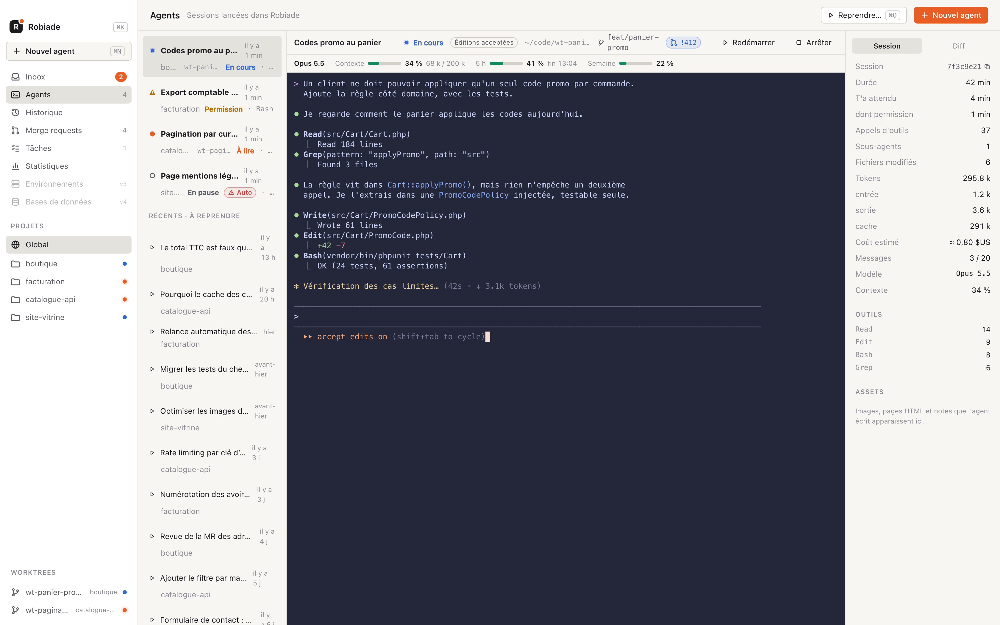
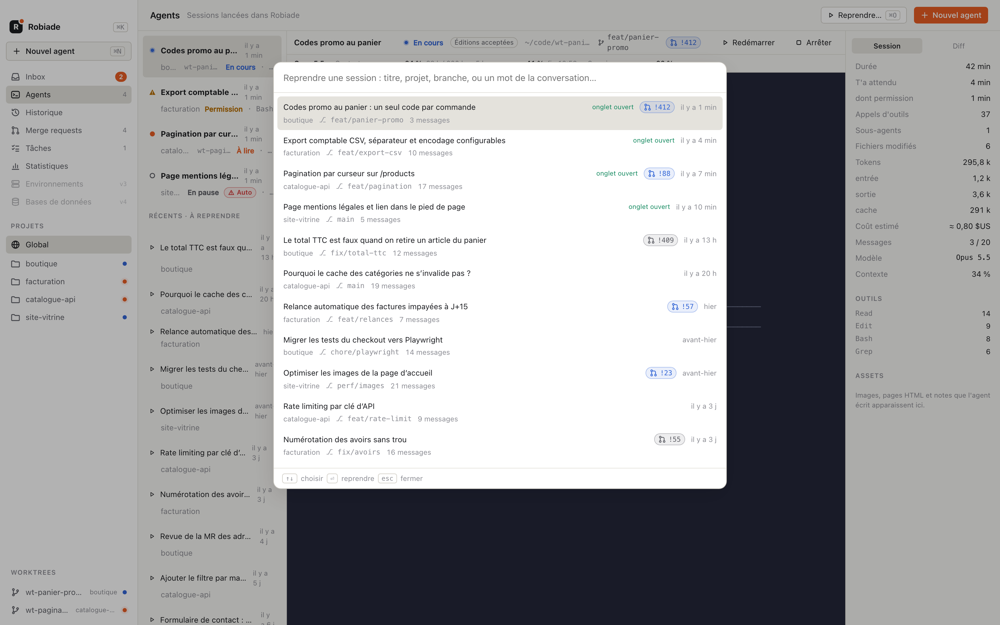
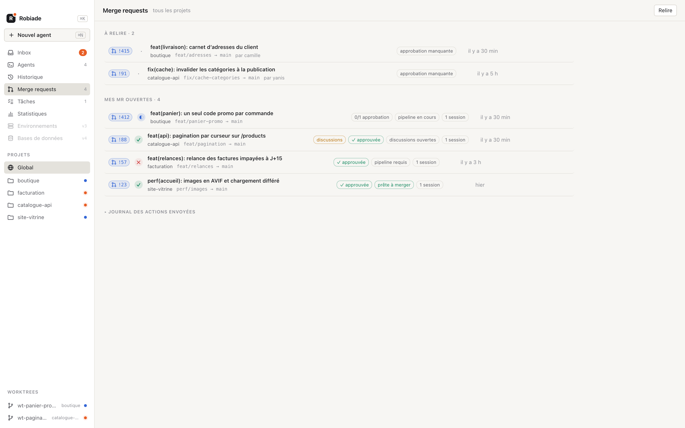
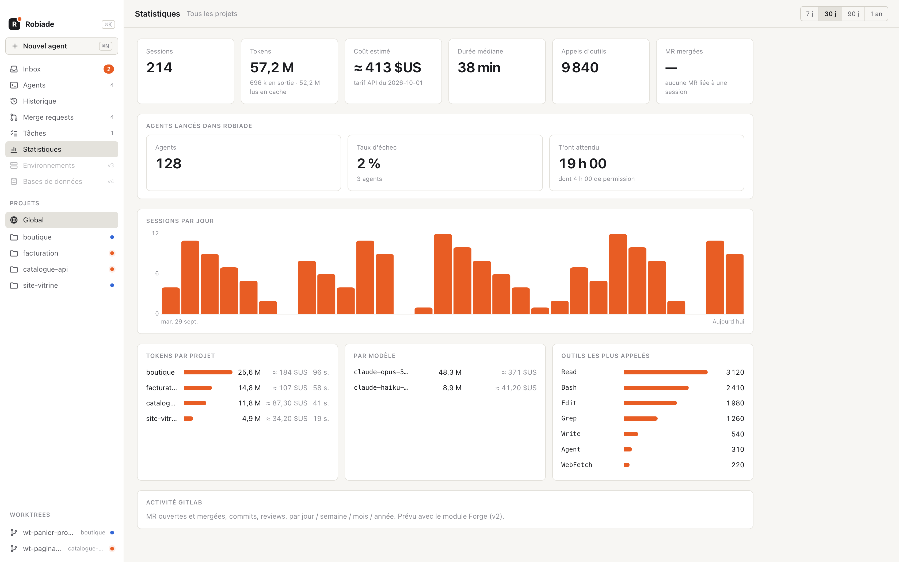

# Robiade

**Le poste de pilotage de mes agents Claude Code.** Tous les agents sur un seul écran, leur état
visible d'un coup d'œil, et les MR GitLab qu'ils produisent juste à côté.



## Ce que ça fait

- **Des agents dans de vrais terminaux.** Robiade lance le vrai CLI `claude` dans un PTY. Rien n'est
  réimplémenté : chaque agent garde ses raccourcis, ses skills et ses hooks. Son statut s'affiche en
  direct (au travail, en attente d'une permission, terminé).
- **Retrouver n'importe quelle session en quelques secondes.** ⌘O fonctionne comme `/resume`, avec
  une recherche plein texte dans les conversations. Les exécutions scriptées (`claude -p`, Agent SDK)
  n'y apparaissent pas.
- **GitLab sans ouvrir GitLab.** MR, pipelines, approbations et issues par projet. On démarre un
  agent depuis une issue : le worktree, la branche et le prompt sont préparés, il ne reste qu'à
  relire. Toute action d'écriture est confirmée et tracée dans un journal.
- **Ce que coûtent les agents.** Tokens, coût par modèle et outils utilisés, par session et au global.
- **Tâches perso** par projet, à côté des issues d'équipe.





## Sécurisé par conception

- Aucun port réseau ouvert : les hooks remontent par un socket Unix en `0600`, avec contrôle de l'UID.
- Le token GitLab est dans le Keychain et n'est jamais transmis à l'interface.
- Robiade est une vue : sessions, Git et GitLab restent les sources de vérité. À part les tâches
  perso, supprimer son cache ne fait rien perdre.

## Stack

Tauri 2, cœur Rust en architecture hexagonale (`crates/core` sans aucune I/O, `crates/adapters`
pour le reste), interface en Svelte 5. macOS arm64.

```sh
npm install && npm --prefix ui install
scripts/install.sh # construit et installe /Applications/Robiade.app
npm run dev        # application en mode développement, données à part (dossier dev/)
cargo test         # tests du cœur et des adaptateurs
ui/demo/screens.sh # régénère les captures (données de démo, serveur Vite lancé)
```

L'application installée et un `npm run dev` peuvent tourner en même temps : le second range sa
base, son socket de hooks et son index dans un sous-dossier `dev/`. Modifier le dépôt ne touche
donc plus l'application de tous les jours ; une nouvelle version se prend en relançant
`scripts/install.sh`, puis l'application.

La spécification, avec les décisions et les jalons, est dans [SPEC.md](SPEC.md).
